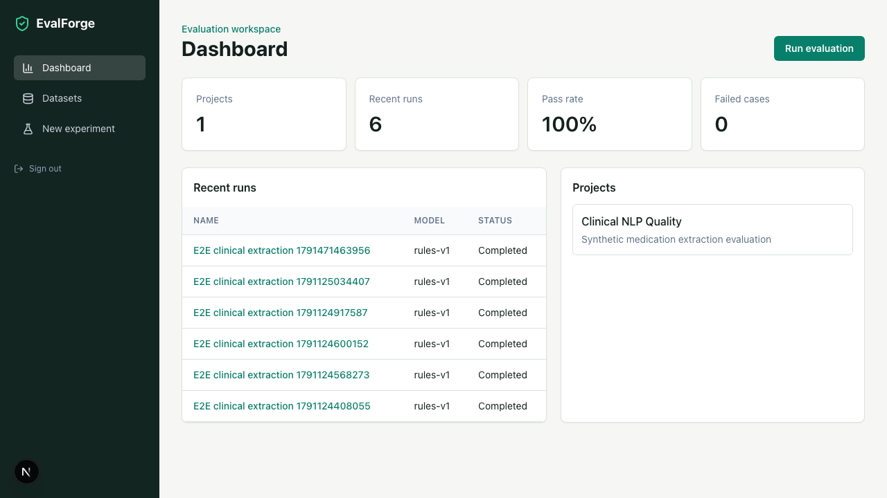
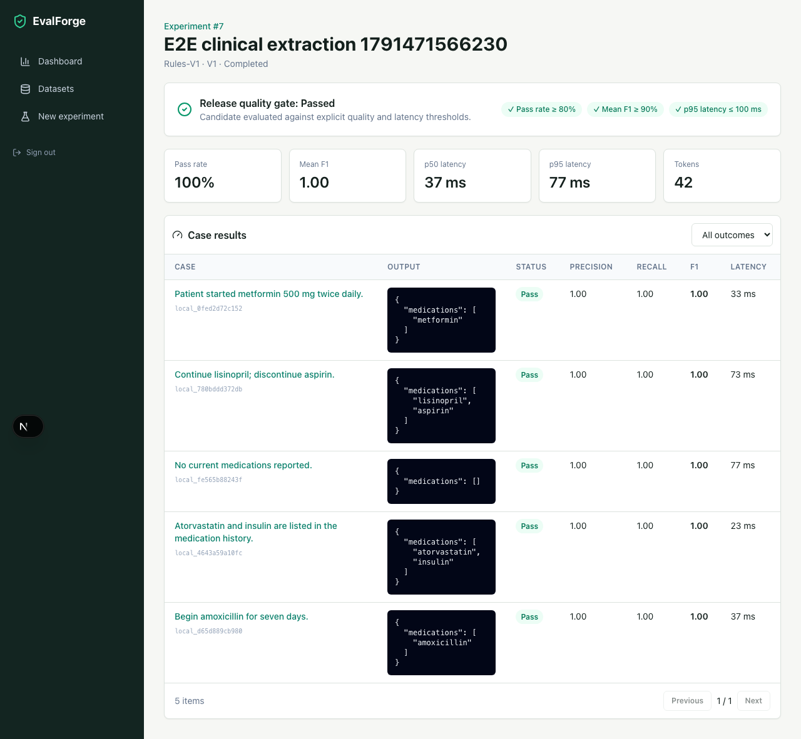
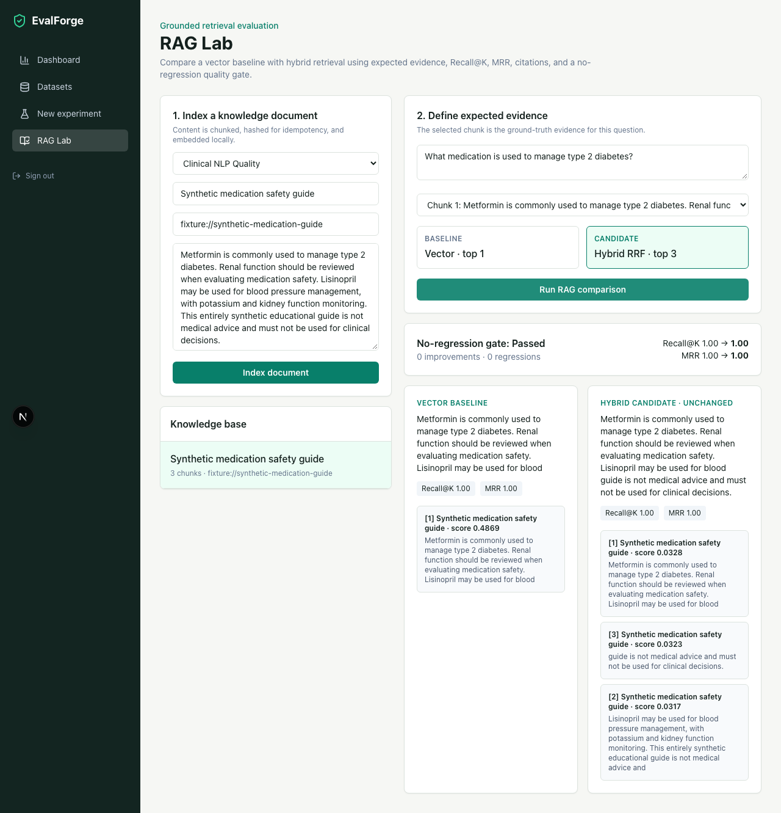
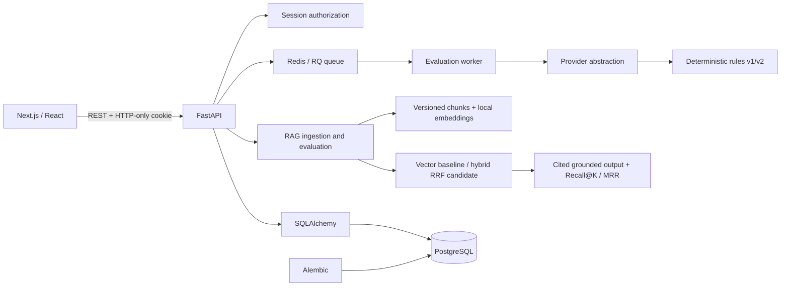

# EvalForge

[](https://github.com/Demianman/EvalForge/actions/workflows/ci.yml)

**AI regression testing that makes model and prompt changes reviewable.** EvalForge is a full-stack evaluation workspace for building test datasets, running reproducible evaluations, comparing candidate versions against a baseline, and recording human review decisions.

The bundled clinical entity extraction data is entirely synthetic. No proprietary code, patient data, or paid model API is required.

## Demo

1. Run `docker compose up --build`.
2. Open `http://localhost:3000`.
3. Sign in with `demo@evalforge.dev` / `demo1234`.

The container startup applies migrations and creates the demo user, project, dataset, and synthetic cases idempotently.

### Screenshots







## Engineering scope

- Next.js App Router, React, TypeScript, Tailwind, shadcn/ui-style Radix primitives, TanStack Query
- FastAPI, Pydantic validation, SQLAlchemy 2, Alembic, PostgreSQL
- Signed, HTTP-only, same-site local session authentication and per-owner authorization
- Dataset/test-case CRUD, search, filtering, pagination, validated CSV/JSON import
- Deterministic provider abstraction with two reproducible local model versions
- Pluggable provider contract with normalized request IDs, token usage, latency, and cost metadata
- Field-level precision/recall/F1 scoring plus schema and exact-match evaluation
- Automated release quality gate using pass-rate, F1, and p95 latency thresholds
- Redis-backed RQ worker with per-case progress, retry backoff, cancellation, and idempotent result creation
- Result metrics, baseline comparison, regression/improvement classification
- RAG knowledge-document ingestion with idempotent SHA-256 content identity and versioned chunks
- Deterministic local feature-hash embeddings plus vector and hybrid reciprocal-rank-fusion retrieval
- Expected-evidence RAG test cases with Recall@K, MRR, citations, regression/improvement classification, and a no-regression gate
- Optimistic human-review mutation with cache snapshot and rollback on API failure
- pytest API tests, Vitest + Testing Library components, lint/typecheck/build CI

## Reproducible RAG benchmark

The committed benchmark uses 60 fixed synthetic queries, identical Top-5
retrieval, and the production retrieval functions. It is an
identifier-heavy engineering benchmark, not a claim about clinical or
production accuracy.

| Chunk size | Vector Recall@5 | Hybrid Recall@5 | Hybrid absolute lift |
|---:|---:|---:|---:|
| 200 | 86.67% | 95.00% | +8.33 pp |
| 800 | 51.67% | 91.67% | +40.00 pp |

With Vector retrieval, increasing chunk size from 200 to 800 reduced Recall@5
by 35.00 percentage points (paired 95% CI -48.33 to -21.67), while Hybrid fell
only 3.33 points (CI -8.33 to 0). The paired robustness advantage was 31.67
points (CI +18.33 to +45.00). See the full
[methodology, MRR, confidence intervals, and limitations](docs/benchmarks/rag-retrieval.md),
or reproduce it with `cd backend && python -m benchmarks.rag_retrieval`.

### What the benchmark searches

The RAG benchmark is separate from the medication entity-extraction demo. Both
use synthetic data, but they test different system boundaries: the demo cases
exercise structured-output evaluation, while the benchmark measures whether a
retriever can find a labelled evidence chunk in a shared corpus.

The benchmark deterministically generates 60 fictional protocol documents.
Each document contains one unique protocol identifier and one unique evidence
marker embedded among repeated workflow vocabulary. A simplified document is:

```text
[synthetic workflow filler]
Protocol hcx-0000 uses evidence marker amber-0000 for its synthetic
escalation checkpoint. This benchmark statement is fictional.
[synthetic workflow filler]
```

Its corresponding query and preassigned ground truth are:

```text
Query: Which evidence marker controls the escalation checkpoint for protocol hcx-0000?
Expected evidence: the chunk containing both hcx-0000 and amber-0000
```

Every query searches the complete corpus, not only its source document. With
10% overlap, the current generator produces 360 candidate chunks at the
200-token setting and 120 candidate chunks at the 800-token setting. A query
is a Recall@5 hit only when its preassigned evidence chunk appears in the five
returned chunk IDs. Its reciprocal-rank contribution is `1 / rank` for the
first correct result, or zero when the expected chunk is absent from the Top-5.

The corpus, questions, and ground-truth mapping are generated in
[`backend/benchmarks/rag_retrieval.py`](backend/benchmarks/rag_retrieval.py).
All content is fictional and contains no patient records, medical advice, or
employer data. The setup is intentionally identifier-heavy and does not
represent general clinical retrieval quality.

## Architecture



TanStack Query owns server state: datasets, runs, result pages, metrics, and reviews. Component state is limited to ephemeral UI concerns such as selected rows, filters, form input, and pagination position. This keeps API cache invalidation explicit while avoiding a global client-state store with duplicated server data.

## Local development without Docker

Backend (SQLite is the development fallback):

```bash
cd backend
python -m venv .venv
source .venv/bin/activate
pip install -r requirements.txt
alembic upgrade head
python -m app.seed
uvicorn app.main:app --reload
```

Frontend:

```bash
cd frontend
npm install
npm run dev
```

## API overview

| Area | Endpoints |
|---|---|
| Auth | `POST /api/auth/login`, `POST /api/auth/logout`, `GET /api/auth/me` |
| Projects | `GET/POST /api/projects` |
| Datasets | `GET/POST/PUT/DELETE /api/datasets`, case CRUD, `/import` |
| Experiments | create/list/detail, paginated `/results`, `/compare` |
| Review | `GET /api/results/:id`, `PUT /api/results/:id/review` |
| RAG Lab | document ingestion/list/chunks, create/read retrieval evaluations |

Errors use a consistent `{ "error": { "code", "message" } }` envelope. FastAPI also publishes interactive OpenAPI documentation at `http://localhost:8000/docs`.

### Typed API contract

FastAPI response models are the canonical contract. `backend/openapi.json` is exported from the running application schema, and `frontend/lib/api-schema.ts` is generated from it. Frontend domain aliases reference those generated components instead of duplicating response interfaces by hand.

```bash
cd frontend
npm run contracts:generate
```

CI regenerates both artifacts and fails when committed contracts have drifted from the backend models.

## Verification

```bash
cd backend && pytest
cd frontend && npm run test
cd frontend && npm run lint && npm run typecheck && npm run build
cd frontend && npx playwright install chromium && npm run test:e2e
cd backend && python -m benchmarks.rag_retrieval
docker compose up --build --detach && python scripts/compose_smoke.py
docker compose down --volumes --remove-orphans
```

Set `UPDATE_SCREENSHOTS=1` when running the E2E command only when intentionally refreshing the committed portfolio screenshots.

The Playwright test starts isolated local backend/frontend servers and verifies the core sign-in → deterministic evaluation → results workflow in Chromium. The Compose smoke test starts a clean five-service stack and verifies frontend reachability, API/session auth, PostgreSQL-backed seed data, Redis/RQ enqueueing, independent-worker completion, result persistence, and the quality gate. GitHub Actions runs both workflows and tears down all Compose volumes afterward.

### CI release gate

After a run completes, the CLI prints a machine-readable report and exits non-zero if the run is incomplete or violates quality thresholds:

```bash
cd backend
python -m app.cli gate --run-id 42
```

## Decisions and tradeoffs

- **Deterministic first:** a rules provider keeps onboarding and CI free, stable, and offline. Its narrow scope is intentional; an OpenAI/Anthropic adapter can implement the same provider interface later.
- **Queue in Compose, synchronous tests:** Compose uses Redis and a dedicated RQ worker with retry backoff and cancellation. Tests use the same worker function synchronously, keeping CI deterministic without hiding queue boundaries.
- **Local session auth:** a signed, HTTP-only, same-site cookie demonstrates the auth boundary without forcing OAuth setup. Production deployment should add CSRF protection, session rotation/revocation, secure-cookie enforcement, and a managed identity provider.
- **Exact JSON scoring:** this makes pass/fail reproducible. Future evaluators can add schema-aware, semantic, RAG, and LLM-judge scoring.
- **Layered scoring:** exact match remains the release pass/fail signal while field-level precision, recall, and F1 explain partial extraction quality.
- **Offline RAG first:** deterministic feature-hash embeddings make CI reproducible and demonstrate retrieval/evaluation boundaries without paid keys. The storage and retriever interfaces can later move to managed embeddings, PostgreSQL `pgvector`, and a learned reranker; those are not claimed as implemented today.
- **Retrieval before generation:** the current grounded answer is extractive and citation-preserving. This keeps evaluation focused on evidence quality before introducing an LLM generator and its additional hallucination, cost, and latency variables.

## Future work

Provider adapters and encrypted credentials, production `pgvector`, learned reranking, generative answer evaluation, RBAC/workspaces, audit events, dataset and prompt versioning, accessibility audit, and deployment infrastructure remain future work.
